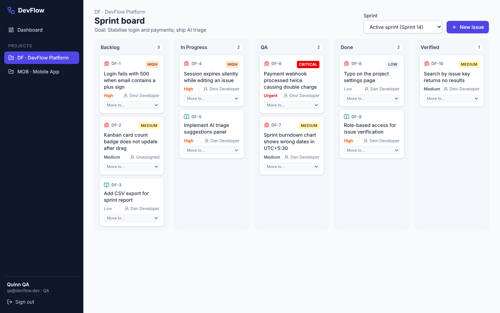
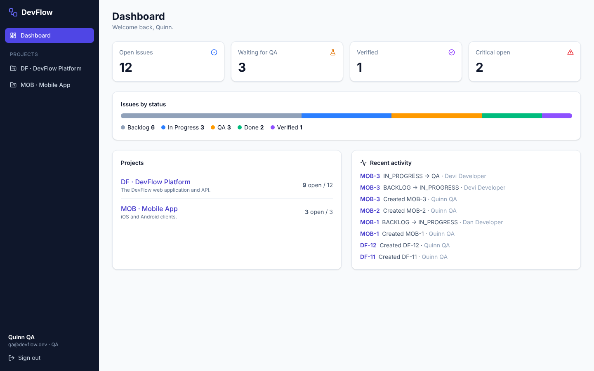
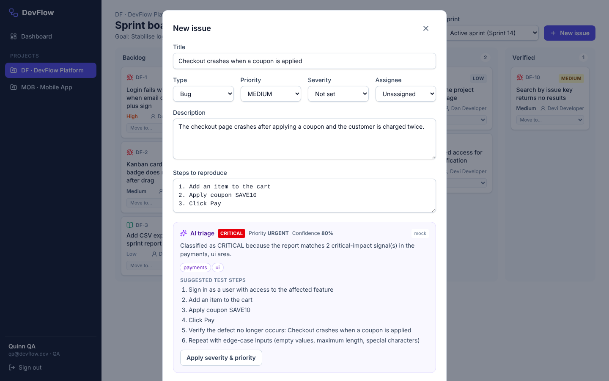
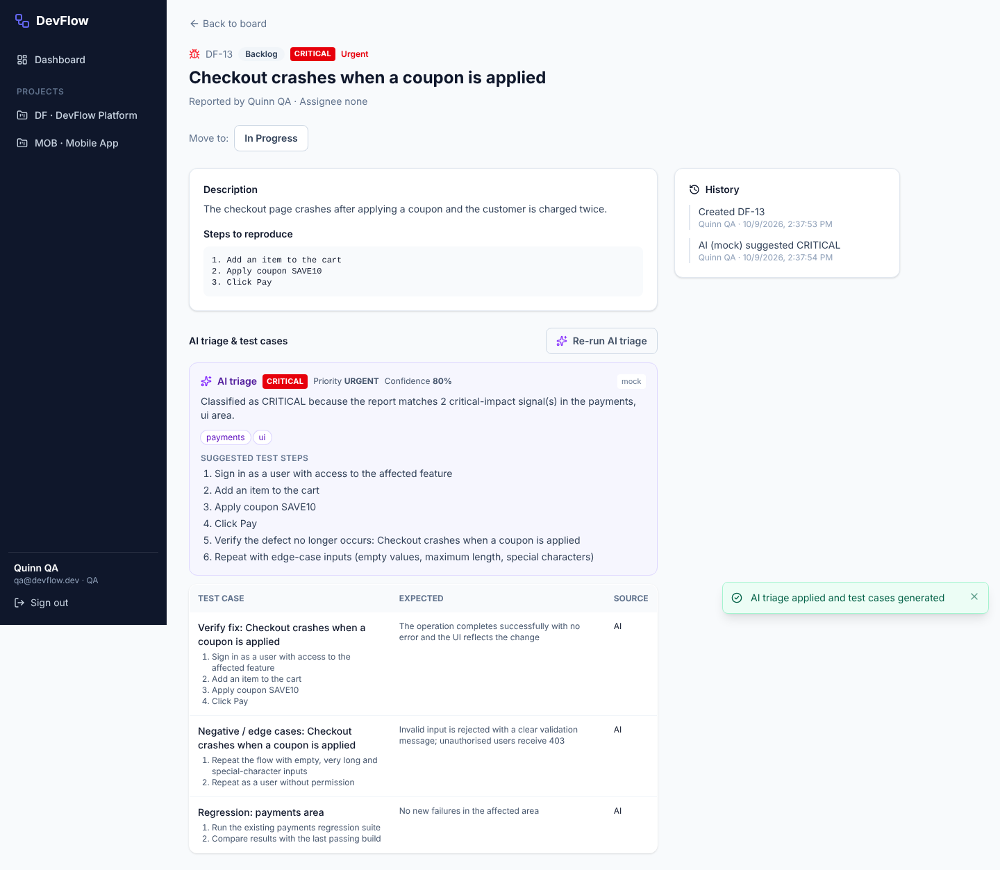
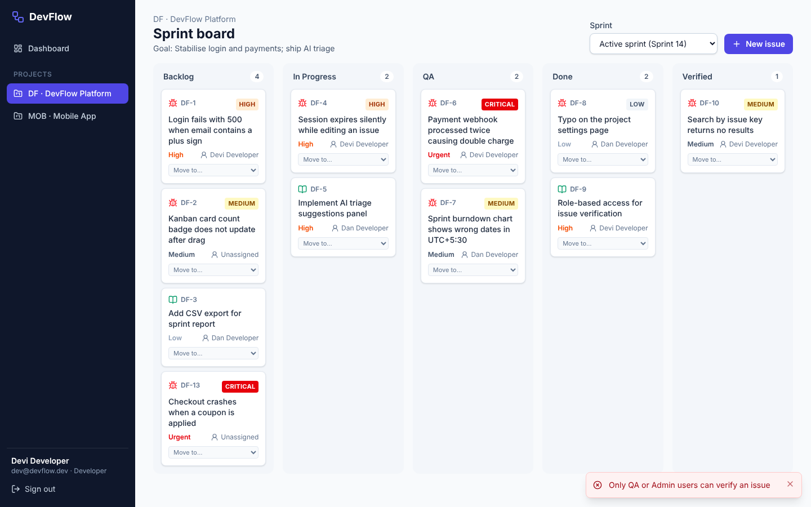

# DevFlow: AI-powered bug tracking & test management

DevFlow is a full-stack bug-tracking and test-management platform with a Kanban sprint board, a role-based issue workflow, and AI triage that suggests a severity and test cases for every bug. It comes with a Playwright test suite, k6 load tests and a GitHub Actions pipeline.



| Layer | Technology |
|---|---|
| Frontend | **Next.js 16** (App Router), React 19, **Tailwind CSS 4**, **Lucide** icons |
| Backend | **Node.js + Express 5** (TypeScript), Zod validation, JWT auth (httpOnly cookie or Bearer token), helmet, rate limiting |
| Database | **PostgreSQL** with **Prisma ORM 7** (TypeScript client + `pg` driver adapter), migrations, seed script |
| AI service | Pluggable triage provider: a deterministic **mock** (default, offline) or **Claude** (Anthropic API), with schema validation and automatic fallback |
| QA automation | **Playwright (TypeScript)**: Page Object Model, custom fixtures, environment-driven config, JSON Schema contract tests |
| Performance | **k6** load test for the sprint-board endpoints, with SLO thresholds |
| CI/CD | **GitHub Actions**: type-check, build, migrate, drift check, seed, Playwright (headless), k6 smoke, reports as artifacts |

**Test status:** 84/84 Playwright tests passing (71 API + 13 E2E). See [docs/test-results](docs/test-results/playwright-summary.md).

---

## Contents
1. [Quick start (Windows / macOS / Linux)](#1-quick-start)
2. [Repository layout](#2-repository-layout)
3. [Architecture & key decisions](#3-architecture--key-decisions)
4. [Features](#4-features)
5. [API reference](#5-api-reference)
6. [QA automation suite](#6-qa-automation-suite-packagesautomation)
7. [Performance testing (k6)](#7-performance-testing-k6)
8. [CI/CD pipeline](#8-cicd-pipeline-githubworkflowsciyml)
9. [AI collaboration notes](#9-ai-collaboration-notes)

---

## 1. Quick start

**Prerequisites:** Node.js **22.12 or later** (24 LTS recommended) and Git. **You do not need to install PostgreSQL**: `npm run db:start` downloads and runs a real PostgreSQL 17 server through npm (`embedded-postgres`). If you already have PostgreSQL, Docker or a cloud database, put its URL in `DATABASE_URL` and skip that step.

```bash
# 1. Install dependencies and create your local config
npm install
copy env.example .env            # macOS/Linux: cp env.example .env

# 2. Terminal 1 – start PostgreSQL (keep this window open; Ctrl+C stops it)
npm run db:start

# 3. Terminal 2 – generate the Prisma client, run migrations, seed demo data, build
npm run setup

# 4. Run the app
npm start                        # API http://localhost:4000 · Web http://localhost:3000
```

For development with hot reload, run `npm run dev` instead of `npm start`.

**Demo accounts** (password `DevFlow@2026`):

| Email | Role | Can do |
|---|---|---|
| `admin@devflow.dev` | Admin | Everything, including project management |
| `qa@devflow.dev` | QA | Create and edit issues, **verify** and reopen verified issues, manage sprints |
| `dev@devflow.dev`, `dev2@devflow.dev` | Developer | Create and edit issues and move them up to **Done**. Cannot verify |
| `viewer@devflow.dev` | Viewer | Read-only |

### Running the tests
```bash
npx playwright install chromium   # one-time browser download
npm test                          # all 84 tests; starts the built servers automatically if they aren't running
npm run test:api                  # API project only
npm run test:e2e                  # browser E2E project only
npm run test:report               # open the HTML report
npm run perf:smoke                # k6 (install first: winget install k6 --source winget)
```

**Note:** the tests reset the database to the seed data before every test (`POST /api/test/reset`, enabled by `ENABLE_TEST_ROUTES=true` in `.env`). Don't run them against data you want to keep.

### Useful scripts
| Script | Purpose |
|---|---|
| `npm run db:start` | Start the embedded PostgreSQL (port 5433, data in `.devflow-db/`) |
| `npm run db:setup` | `prisma generate` + `prisma migrate deploy` + seed |
| `npm run db:seed` | Reset to the demo data set |
| `npm run typecheck` | `tsc --noEmit` in every workspace |
| `npm run build` / `npm start` | Production build, then run the API and web app together |

---

## 2. Repository layout

npm workspaces monorepo:

```
devflow/
├── apps/
│   ├── backend/                     Express 5 + TypeScript API
│   │   ├── prisma/
│   │   │   ├── schema.prisma        data model (users, projects, sprints, issues, events, test cases)
│   │   │   ├── migrations/          SQL migrations (prisma migrate deploy)
│   │   │   └── seed.ts              demo data entry point
│   │   ├── prisma.config.ts         Prisma 7 config (schema, migrations, datasource)
│   │   └── src/
│   │       ├── app.ts / server.ts   app factory (helmet, CORS, JSON limit, routes) + graceful shutdown
│   │       ├── config/env.ts        Zod-validated environment (fails fast on bad config)
│   │       ├── middleware/          auth (JWT + RBAC guards), validate (Zod), errorHandler, requestId
│   │       ├── routes/index.ts      route table: who may call what
│   │       ├── controllers/         thin HTTP layer
│   │       ├── services/            business logic: issues, workflow state machine, board, AI triage
│   │       │   └── ai/              mockProvider · claudeProvider · triageService (fallback)
│   │       ├── schemas/             Zod request contracts (+ the AI output contract)
│   │       └── db/seed.ts           seed data (shared by `npm run db:seed` and the test reset endpoint)
│   └── frontend/                    Next.js 16 App Router + Tailwind 4 + Lucide
│       ├── app/login                sign-in page
│       ├── app/(app)/dashboard      KPIs, status distribution, projects, activity feed
│       ├── app/(app)/projects/[projectId]/board   Kanban sprint board (drag & drop)
│       ├── app/(app)/issues/[id]    issue detail, AI triage, generated test cases, history
│       ├── components/              KanbanBoard, CreateIssueDialog, AiTriagePanel, AppShell, …
│       └── lib/                     API client, types, constants
├── packages/
│   ├── automation/                  Playwright (TypeScript)
│   │   ├── config/env.ts, envs/     TEST_ENV=local|ci|staging – no hard-coded URLs
│   │   ├── fixtures/test.ts         custom fixtures: per-role API clients, data reset, page objects
│   │   ├── pages/                   Page Objects: Login, AppShell, Dashboard, Board, CreateIssueDialog, Issue
│   │   ├── api/DevflowApi.ts        typed API client (API "page object")
│   │   ├── schemas/*.schema.json    JSON Schema contracts (issue, board, error, triage)
│   │   ├── tests/api/               71 API tests
│   │   ├── tests/e2e/               13 browser tests
│   │   └── global-setup.ts          waits for the API, resets data, saves a login session per role
│   └── performance/                 k6 load tests (scripts/, lib/config.js, README)
├── scripts/embedded-db.mjs          zero-install PostgreSQL for local development
├── .github/workflows/ci.yml         GitHub Actions pipeline
└── docs/                            screenshots and test results
```

---

## 3. Architecture & key decisions

```
Browser ──► Next.js (3000) ──/api/* rewrite──► Express API (4000) ──Prisma──► PostgreSQL
                                                     │
                                                     └──► AI provider: mock │ Claude (fallback → mock)
```

| # | Decision | Why |
|---|---|---|
| 1 | **The browser only talks to the Next.js origin.** `/api/*` is proxied to Express through `next.config.ts` rewrites. | One origin, so the **httpOnly, SameSite=Lax** session cookie works without browser CORS. API clients and tests can also use `Authorization: Bearer`. |
| 2 | **The workflow is a server-side state machine** (`services/workflow.ts`). | The rules live in one place and the UI only gives hints. An impossible move returns **409 `INVALID_TRANSITION`** with the allowed targets; a forbidden move returns **403 `FORBIDDEN_TRANSITION`**. |
| 3 | **RBAC in two layers.** Route guards (`requireRole`, `requireWriter`) handle *who may call an endpoint*; workflow rules handle *who may make a transition* (only QA/Admin can enter or leave **Verified**). | Endpoint permissions and business rules are different concerns. The user is reloaded on every request, so a role change takes effect immediately. |
| 4 | **Zod at the edge, `.strict()` everywhere.** | Unknown fields return 400, which prevents mass assignment (for example sending `status` or `reporterId` on create). Text is trimmed and control characters are rejected. |
| 5 | **One error contract:** `{ error: { code, message, details?, requestId } }`. | It is tested with JSON Schema, and the `x-request-id` header links client errors to server logs. Internals never leak; Prisma errors map to 400, 404 or 409. |
| 6 | **Issue numbers come from an atomic per-project counter** (`Project.issueSeq` incremented in a transaction). | Keys like `DF-42` never collide under concurrent creates. |
| 7 | **Fractional `position`** for card order. | A drop between two cards never renumbers the column. |
| 8 | **AI is advisory and pluggable.** The mock is the default; Claude output must pass the `TriageResult` Zod contract, and any failure falls back to the mock with `provider: "mock-fallback"`. The bug report is wrapped in `<bug_report>` tags and treated as untrusted. | Filing a bug never depends on an external API. Tests stay deterministic and CI is free, and LLM output is validated rather than trusted. |
| 9 | **Prisma 7 with the `pg` driver adapter**, client generated into `src/generated`. | The current Prisma architecture: no Rust query engine at runtime and a typed ESM client. |
| 10 | **Test isolation through a reset endpoint** (only when `ENABLE_TEST_ROUTES=true`, refused if `NODE_ENV=production`). Seed users have **fixed UUIDs**. | Every test starts from identical data, and saved login sessions stay valid across resets. |
| 11 | **Embedded PostgreSQL for local development.** | A real PostgreSQL with no install or admin rights, which matters on locked-down Windows laptops. CI uses the official `postgres:17` service. |

### Data model
`User (role: ADMIN | QA | DEVELOPER | VIEWER)` · `Project (key, issueSeq)` · `Sprint (PLANNED | ACTIVE | COMPLETED, one active per project)` · `Issue (key, status, type, severity, priority, position, aiTriage JSON)` · `IssueEvent` (audit trail of every change) · `TestCase (source: AI | MANUAL)`

### Issue workflow
```
BACKLOG ⇄ IN_PROGRESS ⇄ QA → DONE → VERIFIED
               ↑                │        │
               └──── reopen ────┴────────┘      (entering or leaving VERIFIED: QA / Admin only)
```

---

## 4. Features

| | |
|---|---|
|  | **Dashboard:** open issues, issues waiting for QA, verified and critical counts, a status-distribution bar, projects, and recent activity. |
|  | **AI triage while filing a bug:** "Suggest with AI" returns a severity, priority, confidence, rationale, labels and test steps (taken from the reported steps). *Apply* copies the severity and priority into the form. |
|  | **Issue detail:** run AI triage to store the result, set the severity and generate test cases (positive, negative/edge and regression). Includes the full audit history. |
|  | **RBAC on the board:** a developer drags a card to *Verified*, the API returns 403, the card snaps back and a toast explains why. |

The Kanban board supports **native drag and drop** with optimistic updates that roll back on error, and a **keyboard-accessible "Move to…" menu** on every card. Columns are labelled regions, so tests and screen readers find them by role.

---

## 5. API reference

All endpoints are under `/api`. Every endpoint except `health`, `auth/login` and `auth/logout` needs a session cookie or a Bearer token.

| Method & path | Who | Notes |
|---|---|---|
| `GET /health` | public | Includes a database check |
| `POST /auth/login` · `POST /auth/logout` · `GET /auth/me` | public / any | Rate-limited login; the same 401 message for an unknown email or a wrong password |
| `GET /projects` · `GET /projects/:projectId` | any | |
| `POST/PATCH/DELETE /projects[/:projectId]` | Admin | |
| `GET /projects/:projectId/board?sprintId=` | any | Five workflow columns; defaults to the active sprint, `backlog` for issues with no sprint |
| `GET/POST /projects/:projectId/sprints` · `PATCH/DELETE /sprints/:id` | any / QA, Admin | Only one active sprint per project (409) |
| `GET /issues?projectId&status&type&severity&assigneeId&q&page&pageSize&sort` | any | Paginated |
| `POST /issues` | Admin, QA, Developer | 201 + `Location` header. Strict schema |
| `GET/PATCH/DELETE /issues/:id` | any / writers | Delete: reporter or Admin |
| `POST /issues/:id/transition` `{ toStatus, index? }` | writers + workflow rules | 409 invalid transition · 403 role not allowed |
| `GET /issues/:id/events` · `GET /issues/:id/test-cases` | any | |
| `POST /ai/triage` `{ title?, description, stepsToReproduce? }` | writers | Returns `{ severity, suggestedPriority, confidence, rationale, labels, suggestedTestSteps, suggestedTestCases, provider, model, latencyMs }` |
| `POST /issues/:id/triage` `{ applySeverity?, createTestCases? }` | writers | Persists the triage result and AI test cases. Re-running replaces earlier AI cases |
| `POST /test/reset` | test only | Only when `ENABLE_TEST_ROUTES=true` and not in production |

**Status codes:** 200 · 201 · 204 · 400 `VALIDATION_ERROR` / `MALFORMED_JSON` · 401 · 403 · 404 · 409 · 413 · 429 · 500 (generic, no internals).

**Real AI:** set `AI_PROVIDER=claude` and `ANTHROPIC_API_KEY=…` in `.env` (and optionally `AI_MODEL`). If the API call fails, times out or returns invalid JSON, the response falls back to the mock and says so.

---

## 6. QA automation suite (`packages/automation`)

**Design**
- **Page Object Model.** `LoginPage`, `AppShell`, `DashboardPage`, `BoardPage` (columns, cards, `drag()`, `moveWithMenu()`, `counts()`), `CreateIssueDialog` and `IssuePage`, plus a typed **`DevflowApi`** client for API tests.
- **Fixtures** (`fixtures/test.ts`):
  - `apiAs(role)` creates authenticated API clients that are disposed after each test;
  - `resetDatabase` (auto) restores the seed data before each test;
  - `dfProject` provides the seeded DF project and its active sprint;
  - `uniqueTitle` generates unique issue titles;
  - the page objects are injected as fixtures;
  - `authFile(role)` returns the login session that `global-setup.ts` saved for that role.
- **Environment-driven:** `TEST_ENV=local|ci|staging` selects `config/envs/<env>.env` (`BASE_URL`, `API_URL`, `START_SERVERS`). `webServer` starts the built app when it isn't already running.
- **Locators:** role, label and test-id only (`getByRole('region', { name: 'Done' })`, `getByRole('article', { name: /^DF-12:/ })`). No CSS or XPath.
- **Reporters:** list, HTML, JUnit and JSON. Traces, screenshots and videos are kept on failure.

**E2E tests (13)**

| Spec | Covers |
|---|---|
| `auth.e2e.spec.ts` | Login as Admin, QA and Developer. Wrong password. A protected page redirects to login and back. Sign-out really clears the session |
| `issue-lifecycle.e2e.spec.ts` | **Create an issue in the UI, drag it Backlog → In Progress → QA → Done** with column counts, toasts and the API checked at each step. **Reload to check persistence.** QA verifies it in a second browser session. The issue page shows the audit trail. Keyboard "Move to" menu. An invalid jump snaps back with an error |
| `rbac.e2e.spec.ts` | A developer's drag to *Verified* returns 403, the UI rolls back and nothing changes after reload. A viewer sees no create button, no draggable cards and no move menu |
| `ai-triage.e2e.spec.ts` | AI suggestion in the create dialog, applied and then created with the CRITICAL badge. Run triage on an issue and check the test-case table and history |

**API tests (71)**

| Spec | Covers |
|---|---|
| `issues.contract.api.spec.ts` | **JSON Schema contract validation** (Ajv, draft 2020-12, `additionalProperties: false`) for create (minimal and full payloads), get, list and board responses, and the shared error contract for 400/401/403/404/409 including the request-id header. Checks for password-hash leaks across endpoints. Sequential keys |
| `issues.validation.api.spec.ts` | 15 invalid-payload cases, each naming the failing field. Invalid references (other project's sprint, missing user). Malformed JSON. 413 for bodies over 64 KB. 7 boundary values that must be accepted (3 and 200 chars, 10,000-char description, emoji, HTML/SQL text stored as plain text, trimming) |
| `workflow.api.spec.ts` | Happy path with `allowedTransitions` per role and the event history. Six illegal jumps return 409 with the status unchanged. Unknown status. Drop-index ordering |
| `rbac.api.spec.ts` | Verify matrix (admin 200, QA 200, developer 403, viewer 403). Reopening a verified issue. Viewer read-only checks on 6 endpoints. Project administration. Delete ownership |
| `ai-triage.api.spec.ts` | Seven classification cases. Determinism. Reproduction steps reused as test steps. **A prompt-injection attempt doesn't change the result.** Validation. The issue-triage endpoint persists results and stays idempotent |
| `auth.api.spec.ts` | JWT and cookie flags (HttpOnly, SameSite). Case-insensitive email. No account enumeration. 401 on protected routes. A tampered token is rejected |

**Proving the tests can fail.** I made five deliberate bugs, one at a time, and checked that the suite went red each time. The code was restored afterwards.

| Bug introduced | Result |
|---|---|
| Developers allowed to verify | 2 API tests failed, plus 1 E2E test |
| Backlog → Done allowed | 3 API tests failed |
| `passwordHash` added to the user summary | 13 contract tests failed |
| "crash" no longer treated as critical | 2 AI tests failed |

---

## 7. Performance testing (k6)

`packages/performance/scripts/sprint-board.js` models a person working the board. Each iteration loads the board, the issue list and the sprints, sometimes drags a card one column and back (`WRITE_RATIO`, default 10%), then pauses for 1–3 seconds.

- **Profiles:** `smoke` (2 VUs for 30 s, used in CI), `load` (ramp to 20 VUs and hold 2 min) and `stress` (up to 100 VUs).
- **Thresholds:**
  - error rate below 1%;
  - board p95 under 500 ms and p99 under 1 s;
  - issue list p95 under 500 ms;
  - card move p95 under 800 ms;
  - checks above 99%.

  A breached threshold fails the run. **409 is counted as an expected response** for concurrent card moves, so correct conflict handling isn't reported as an error.
- `--summary-export` writes `packages/performance/results/summary.json`. See [packages/performance/README.md](packages/performance/README.md).

---

## 8. CI/CD pipeline (`.github/workflows/ci.yml`)

| Job | Steps |
|---|---|
| **quality** | `npm ci`, then `prisma generate`, then type-check all workspaces, then build the backend and frontend |
| **e2e** (needs quality) | `postgres:17` service container, then **`prisma migrate deploy`**, then a **migration drift check** (`prisma migrate diff --from-config-datasource --to-schema --exit-code`), then **seed**, then build, then cached Playwright Chromium, then **`npm test` headless**. Publishes a Markdown summary to the job page and uploads the HTML/JUnit report (and traces, screenshots and videos on failure) |
| **performance** (needs quality) | Postgres, migrate, seed, start the API, `grafana/setup-k6-action`, **k6 smoke**. Fails on breached SLOs and uploads `summary.json` |

The pipeline triggers on pushes to `main`, on pull requests and manually. Concurrent runs on the same branch are cancelled, and the workflow token is read-only.

---

## 9. AI collaboration notes

**How AI was used.** I wrote the specification: the stack, the folder structure, the functional requirements (CRUD, workflow, AI triage, RBAC) and the QA requirements. I used Claude as a pair programmer to design the architecture and implement it across all layers. I then ran it, reviewed it and tested it on my own machine.

**What worked well**
- Fast scaffolding of a consistent monorepo: the contracts (Zod on the server, JSON Schema in the tests, TypeScript types in the UI) were designed together.
- **Tests caught real problems during development:**
  - **A flaky drag test.** Once the board filled up, a column's centre point was below the viewport, so the drop landed on the wrong element and Playwright dragged a *different* card. The fix had two parts: drop on the column header, and reset the data before every test. Resetting worked because seed users have **fixed UUIDs**, so saved sessions survive the reset.
  - **An ambiguous locator.** Next.js injects a hidden `role="alert"` route announcer, which made `getByRole('alert')` match two elements. The login error is now located inside the sign-in form.
- **Mutation testing** (section 6) proved the RBAC, workflow, contract and AI tests fail when the behaviour breaks.

**What needed correcting or a judgement call**
- **Environment limits during development.** The build environment couldn't download Prisma's native schema engine. Migrations were generated with Prisma's official WebAssembly schema engine at the *same engine version* (7.10.0), and CI re-checks them with the native CLI (the drift check). The k6 script was checked against the live API with a small simulation of the k6 APIs. Real k6 runs happen in CI and with `npm run perf:smoke`.
- **A Windows-only bug found on the first real run.** On Windows, `initdb` picked up the system locale, so the embedded database was created as **WIN1252**. Seeding then failed because WIN1252 can't store characters such as `→` in issue history. `scripts/embedded-db.mjs` now always initialises the cluster as UTF-8 (`--encoding=UTF8 --locale=C`). On every start it also checks the database encoding and refuses to run, with clear instructions, if an old non-UTF-8 data folder is found. Linux CI never hit this, which shows why the setup was also tested on the target OS.
- **Dependency hygiene.** `npm audit` flagged high-severity advisories in two packages that the Prisma CLI pulls in (`deepmerge-ts`, `mysql2`). npm `overrides` pin patched versions, and `npm audit` now reports 0 vulnerabilities.
- **Version pinning.** `@playwright/test` is pinned to **1.63.0** so its Chromium build matches the one already installed, and Prisma packages are pinned to **7.10.0** because the npm `latest` tag pointed at a release candidate.
- **Weak tests removed.** An early E2E test of the "blocked drop" visual hint didn't really assert behaviour, so it was dropped. The 403 is proven at the API and UI-rollback level instead.

**Takeaway.** AI made it practical to build a full-stack system with a real test strategy quickly. What made it trustworthy were contract tests, mutation checks and a reproducible environment, not the volume of generated code.
